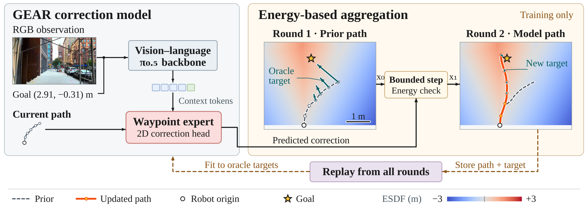
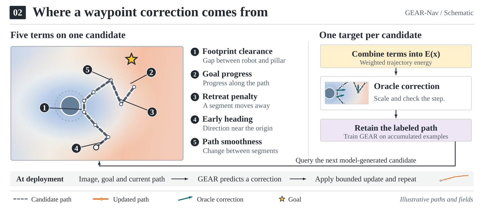
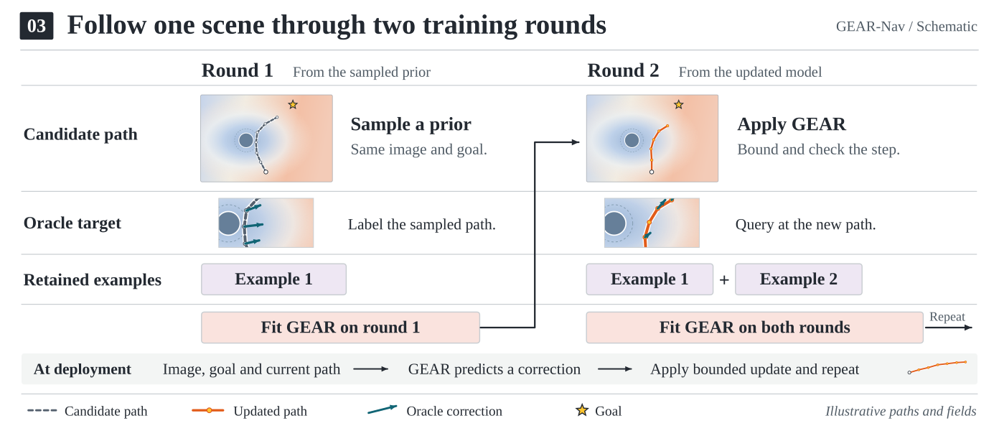

# GEAR-Nav pipeline figure proposals

## Canva page 3 · GEAR learns from its own paths

[Editable SVG](07-canva-training-pipeline.svg) · [Canva import](07-canva-training-pipeline.pptx) · [Vector PDF](07-canva-training-pipeline.pdf)

Round 1 fits GEAR to the saved waypoint corrections in B₁. The updated head produces the next path with an energy-checked step. Round 2 adds B₂ and fits on examples from both banks. Teal arrows depict oracle targets on the path. Orange dashed arrows carry gradients from the correction regression loss back to the action head. The small network drawings identify that head schematically.

The two maps and the tilted ESDF inset use NYC_1 frame 002609 from the recorded replay. Both rounds have the same crop, goal, and arrow scale. The dotted lines in the inset connect four waypoints on the initial path to their coordinates on the flat ESDF. [Replay provenance](../pipeline/assets/aggregation_replay.json)

The typography follows the CoVE qualitative figures, using Arial Bold for headings and Arial for labels.

Run `.venv/bin/python figs/pipeline_proposals/draw_canva_page3.py` to rebuild the SVG, PNG, and PDF. The optional `--pptx` flag uses the [Canva converter](../canva/editable_pptx.py) and its dependencies listed in [build_kit.py](../canva/build_kit.py).

## Figure 2 proposal · Learning a waypoint correction

[Print-size PDF](06-correction-and-replay.pdf) · [Editable SVG](06-correction-and-replay.svg)

Figure 2 in iPlanner places the depth observation, learned representation and waypoint output on one horizontal path. A separate training arrow runs back through the network. ViPlanner’s Figure 2 shows where the depth, semantic and goal representations meet, then draws the costmap beside the trajectory objective. The GEAR proposal uses that visual ordering. The dashed return passes through replay because GEAR fits cached waypoint corrections. [iPlanner, Fig. 2](https://arxiv.org/pdf/2302.11434#page=3) · [ViPlanner, Fig. 2](https://arxiv.org/pdf/2310.00982#page=3)

**Proposed caption.** GEAR encodes the RGB observation and goal, then predicts a correction for each waypoint of the current path. In the first aggregation round, the energy oracle labels the sampled prior. After fitting on replay, the updated model takes a bounded, energy-checked step. The oracle labels the resulting path in the next round. Training samples path–target pairs from all retained rounds. Full-dataset continuation applies the same labeling objective to additional training conditions. At deployment, GEAR repeats the bounded model update using the image, goal and current path.

Both maps and the photograph come from the same training condition, NYC_1 frame 002609. The curves are the archived depth-0 and depth-1 paths from batch 53, slot 2. Teal arrows use the stored pre-projection targets at waypoints 8, 10, 12 and 15, with one display multiplier of 0.34 in both maps. Robot-forward points up. The goal is 2.91 m ahead and 0.31 m to the robot’s right. The token strip is schematic. [Matched replay and source hashes](../pipeline/assets/aggregation_replay.json)

To regenerate this proposal from the repository root, run `.venv/bin/python figs/pipeline_proposals/draw_architecture.py`. The renderer uses the shared figure style, Liberation Serif, `rsvg-convert` and Ghostscript.

## Five schematic alternatives

Five layouts for the RA-L pipeline figure, all drawn with a schematic passage, candidate paths, and oracle directions. Click a figure to open its editable SVG.

[Compare on one sheet](five-pipelines.png) · [View one concept per page in the PDF](five-pipelines.pdf)

To regenerate the SVGs, PNGs and PDF from the repository root, run `.venv/bin/python figs/pipeline_proposals/draw.py`. The generator uses Pillow, `rsvg-convert` and `pdfunite`.
