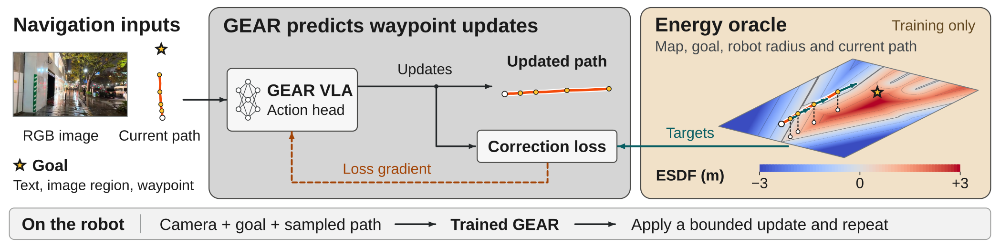
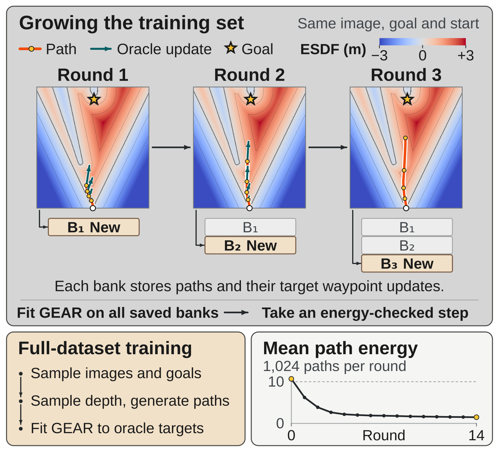
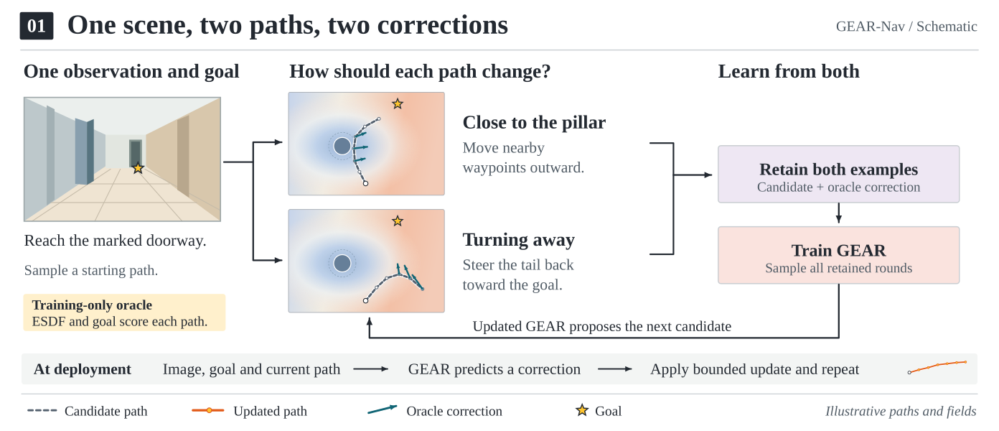
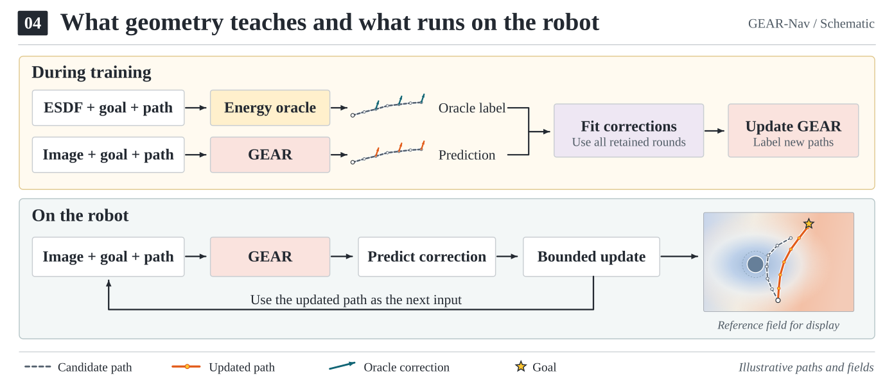
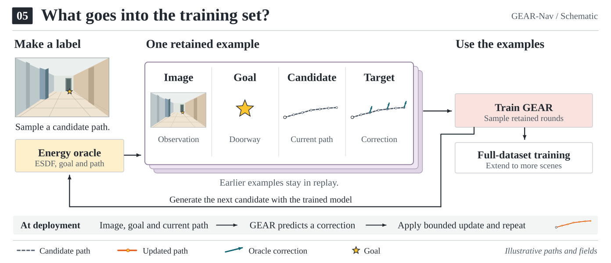

# GEAR-Nav pipeline figure proposals

## Figure 2 · How GEAR learns a waypoint update

[](07-canva-training-pipeline.svg)

[Editable SVG](07-canva-training-pipeline.svg) · [Editable Canva import](07-canva-training-pipeline.pptx) · [Paper PDF, 178 mm wide](07-canva-training-pipeline.pdf)

The camera image, goal and current path feed the VLA. Its action head predicts an update for each waypoint. At training time, an energy oracle uses the scene geometry, metric goal, robot radius and candidate path to supply the local target. The dashed orange arrow shows the gradient of the correction loss flowing back to the model. The robot starts from a sampled path and repeats bounded updates with the trained VLA.

The photo and signed Euclidean distance field (ESDF) are from the rainy sidewalk in teaser panel (b), Japan_5 frame 000398. The current and updated paths are consecutive saved model outputs at steps 2 and 3. The oracle was evaluated on the step-2 path for this illustration of the training rule on a held-out frame. Four dotted stems connect the path to its true map coordinates. Teal arrows show the local targets before rollout projection. The yellow star marks the recorded goal. The full field of view in the diagram is 15 m forward by 12 m across. [Scene data and source hashes](method_examples/provenance.json)

## Figure 3 · Growing the training set

[](08-canva-aggregation.svg)

[Editable SVG](08-canva-aggregation.svg) · [Editable Canva import](08-canva-aggregation.pptx) · [Paper PDF, 86 mm wide](08-canva-aggregation.pdf)

The three maps show the same Ottawa image, goal and fixed starting waypoint in consecutive training rounds. The oracle labels each visited path. Round 1 creates B₁. Round 2 keeps B₁ and adds B₂. Round 3 keeps both and adds B₃. After each round, GEAR fits on all saved banks and takes an energy-checked step to generate the next paths. The paths, goal and target vectors shown here come from Ottawa_1 frame 001351 in batch 53, slot 3 of the archived training run. Each map shows 13 m forward by 12 m across at the same scale. The target vectors get smaller in round 3. [Matched training samples](method_examples/provenance.json)

The graph uses all 1,024 training paths per round. At round 0 it shows mean energy on the initial paths. Each of the next 14 points is the logged mean after the model's energy-checked update. Mean path energy fell from 10.68 to 1.49 during this aggregation run. The adjacent full-dataset training panel shows what happens next. A fixed aggregation checkpoint generates paths at sampled depths for training images and goals. The energy oracle labels those paths and the student learns their updates. [Archived values](method_examples/ottawa-replay.npz) · [Aggregation](../../src/astar/training/aggregation.py) · [Full-dataset training](../../src/astar/training/continuation.py)

### Styling and reproduction

Both figures use the CoVE Canva font, Arial. The gray model panel, sand training panel, black forward connectors and dashed orange gradient follow the layout of ViPlanner's Figure 2. Both maps use one blue-to-red distance scale from −3 to +3 m. The dark contour is the 0 m obstacle boundary. Lighter contours mark −2, −1, +1 and +2 m. All contours are computed from the saved 2 cm ESDF cells. The teal vectors use the same 0.8 display multiplier at waypoint indices 5, 8, 11 and 15 in both figures. Labels, paths, waypoint markers, connectors, banks and the measured energy curve are editable in Canva and the SVG masters. [ViPlanner, Fig. 2](https://arxiv.org/pdf/2310.00982#page=3) · [iPlanner, Fig. 2](https://arxiv.org/pdf/2302.11434#page=3)

Run each renderer from the repository root. The committed example files are sufficient. Add `--pptx` for editable, one-page Canva imports at 1048 × 260 px and 1400 × 1273 px. [Converter](../canva/editable_pptx.py) · [Converter dependencies](../canva/build_kit.py)

```bash
.venv/bin/python figs/pipeline_proposals/draw_canva_page3.py
.venv/bin/python figs/pipeline_proposals/draw_canva_aggregation.py
```

To re-extract the examples on a checkout containing the original dataset, teaser captures and training checkpoint, run `JAX_PLATFORMS=cpu .venv/bin/python figs/pipeline_proposals/prepare_method_examples.py "$PWD"`. The extraction verifies the source hashes, checks all three Ottawa paths and labels against the training archive, and tests the rainy-sidewalk oracle settings against an independently captured label.

## Figure 2 proposal · Learning a waypoint correction

[](06-correction-and-replay.svg)

[Print-size PDF](06-correction-and-replay.pdf) · [Editable SVG](06-correction-and-replay.svg)

Figure 2 in iPlanner places the depth observation, learned representation and waypoint output on one horizontal path. A separate training arrow runs back through the network. ViPlanner’s Figure 2 shows where the depth, semantic and goal representations meet, then draws the costmap beside the trajectory objective. The GEAR proposal uses that visual ordering. The dashed return passes through replay because GEAR fits cached waypoint corrections. [iPlanner, Fig. 2](https://arxiv.org/pdf/2302.11434#page=3) · [ViPlanner, Fig. 2](https://arxiv.org/pdf/2310.00982#page=3)

**Proposed caption.** GEAR encodes the RGB observation and goal, then predicts a correction for each waypoint of the current path. In the first aggregation round, the energy oracle labels the sampled prior. After fitting on replay, the updated model takes a bounded, energy-checked step. The oracle labels the resulting path in the next round. Training samples path–target pairs from all retained rounds. Full-dataset continuation applies the same labeling objective to additional training conditions. At deployment, GEAR repeats the bounded model update using the image, goal and current path.

Both maps and the photograph come from the same training condition, NYC_1 frame 002609. The curves are the archived depth-0 and depth-1 paths from batch 53, slot 2. Teal arrows use the stored pre-projection targets at waypoints 8, 10, 12 and 15, with one display multiplier of 0.34 in both maps. Robot-forward points up. The goal is 2.91 m ahead and 0.31 m to the robot’s right. The token strip is schematic. [Matched replay and source hashes](../pipeline/assets/aggregation_replay.json)

To regenerate this proposal from the repository root, run `.venv/bin/python figs/pipeline_proposals/draw_architecture.py`. The renderer uses the shared figure style, Liberation Serif, `rsvg-convert` and Ghostscript.

## Five schematic alternatives

Five layouts for the RA-L pipeline figure, all drawn with a schematic passage, candidate paths, and oracle directions. Click a figure to open its editable SVG.

[Compare on one sheet](five-pipelines.png) · [View one concept per page in the PDF](five-pipelines.pdf)

[](01-two-paths.svg)

[](02-energy-terms.svg)

[](03-two-rounds.svg)

[](04-training-deployment.svg)

[](05-replay-example.svg)

To regenerate the SVGs, PNGs and PDF from the repository root, run `.venv/bin/python figs/pipeline_proposals/draw.py`. The generator uses Pillow, `rsvg-convert` and `pdfunite`.
