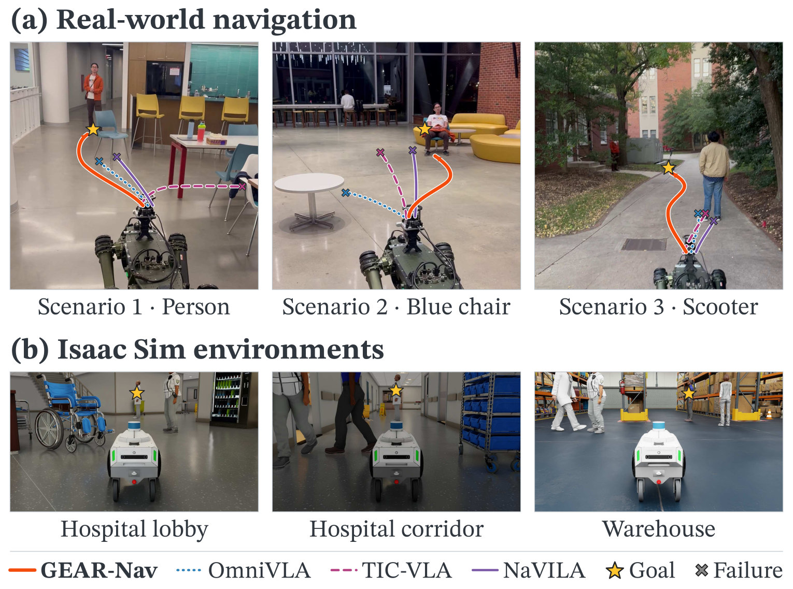

# Real-world navigation and navigation environments

[](gear_realworld_isaacsim.svg)

[Editable SVG](gear_realworld_isaacsim.svg) · [Single-column PDF](gear_realworld_isaacsim.pdf) · [PowerPoint with editable text](gear_realworld_isaacsim.pptx) · [Verified Canva page import](gear_realworld_isaacsim_canva.pptx)

The published version is page 2 of **3 GEAR Realworld** in Canva (design `DAHbx9IfKNo`, page `PBdX3TLkndjXwJC6`). The figure is centered at full height on the 1400 × 924 px canvas. Each STIX label is a separate graphic, and filled vector shapes preserve the path widths and dash patterns. Use the SVG or the editable-text PowerPoint to revise wording.

The figure fits a 3.4-inch paper column. It uses 9 pt STIX Two Text headings, 7.44 pt scene captions, and a 7.2 pt shared legend. GEAR-Nav has a solid orange route. The blue dots, magenta dashes, and violet lines distinguish the three baselines.

In panel (a), GEAR-Nav routes summarize selected recordings. The baseline routes are schematic adaptations of VEGA’s qualitative comparison. Crosses mark reference failures. Panel (b) shows three separate illustrative oracle-goal runs. Gold stars mark the goals in both panels.

The source is `Editable SVG/06-Real-World-and-Isaac-Sim.svg` in the local figure kit. Each photograph and its annotations move together. The SVG metadata records the source checksum and font license. The editable-text PowerPoint contains six photographs, 14 editable labels, and 56 vector shapes. [Source kit](../../canva/GEAR-Nav-Canva.zip)

The first command builds the SVG, PDF, and PNG from the repository root. Add `--pptx` for the PowerPoint with editable text. The second command fits the SVG to the Canva page and exports the lettering and strokes as graphics. Both PowerPoint exports use the figure kit’s dependencies. [Exporter](../../canva/editable_pptx.py) · [Dependencies](../../canva/build_kit.py)

```sh
.venv/bin/python figs/realworld_isaacsim/styled/build.py
.venv/bin/python figs/realworld_isaacsim/styled/build_canva.py
```
