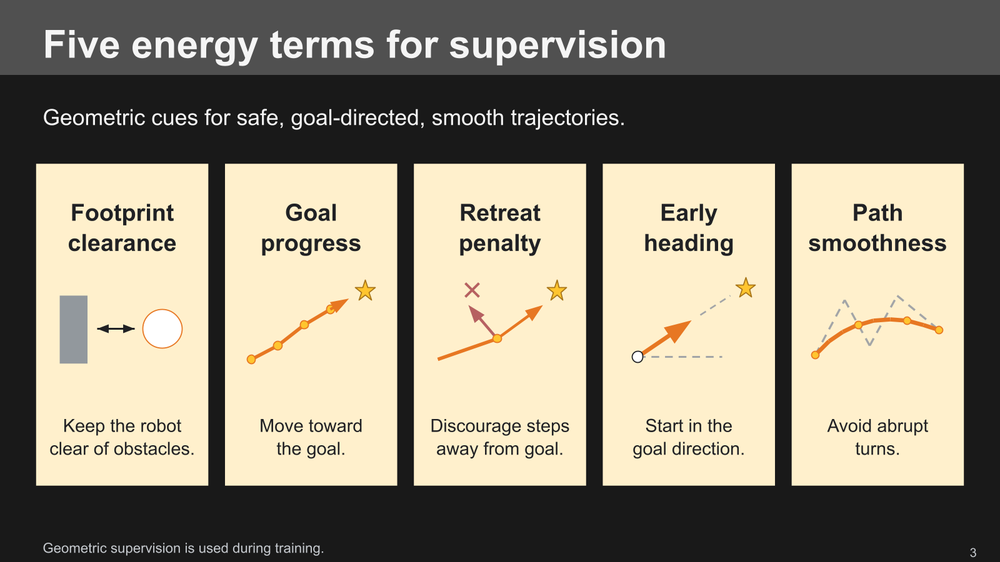

# Slide 3: five energy terms

Updated [slide 3 in the native deck](https://docs.google.com/presentation/d/1LUUqhMl4_GE6BG1YvRhg6KFbFrBVj-uHkU6u_nem1O0/edit?slide=id.gear_video_03)
at the user's request. The complex oracle diagram is replaced by five equal
cards: footprint clearance, goal progress, retreat penalty, early heading,
and path smoothness. Each has one simple schematic and a two-line caption.
All text and illustrations are native editable Google Slides objects.

- `preview.png`: final native Google Slides thumbnail, visually inspected.
- `proof/slide-03.svg`: editable local vector composition.
- `build_slide.py`: emits the local proof, canvas, notes, and native mutation plan.
- `canvas.json`: exact intended geometry and text.
- `speaker-notes.txt`: revised narration and source context.
- `delivery.json`: revision and verification record.
- `issues.json`: native output checker report, zero issues.

Run `.venv/bin/python figs/slides_refinement_20261107/slide3_simplified/build_slide.py`
from the repository to regenerate local artifacts. The script reuses geometry
and rendering helpers from `figs/slides_polish_20261103/polish_deck.py` without
executing that script. It makes no remote writes. Its requests target the
pre-edit slide and must not be replayed against the updated deck.

The five terms follow `figs/pipeline/build_diagram.py`; the energy formulation
is described in `GEAR-Nav Overleaf/main.tex`. The illustrations are conceptual,
not measured trajectories. No new measurements or model inference were used.
The slide describes available formulation terms, without claiming that every
term has nonzero weight in every run. Geometry supplies training supervision.

Validation used native readback and a fresh native thumbnail after the final
caption adjustment. All five captions occupy two lines without clipping;
all five headings and icons are legible. Only slide 3 and its speaker notes
were modified. No video objects were involved.
