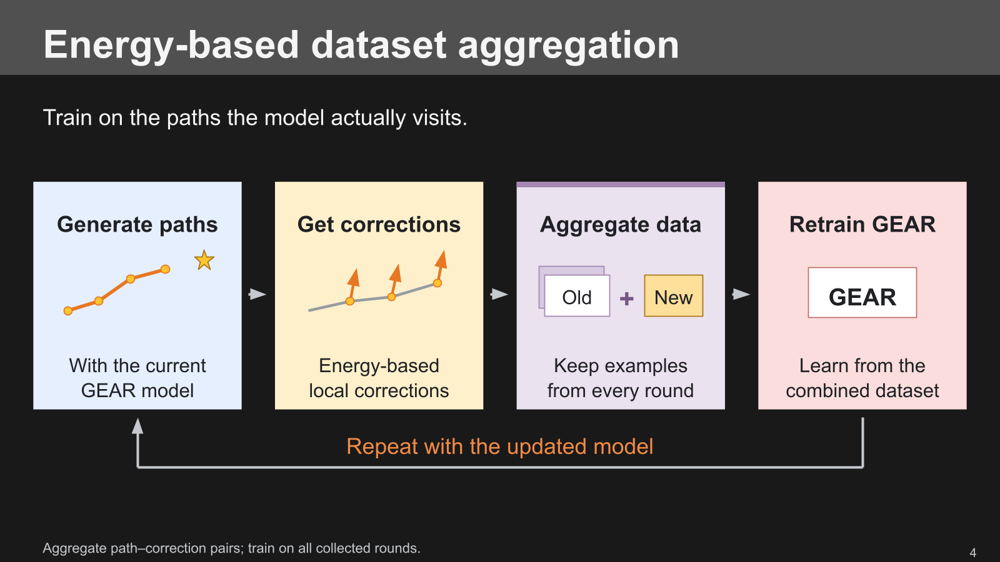

# Slide 4: dataset aggregation

Updated [slide 4 in the native deck](https://docs.google.com/presentation/d/1LUUqhMl4_GE6BG1YvRhg6KFbFrBVj-uHkU6u_nem1O0/edit?slide=id.gear_video_04)
to focus on the user's main point: dataset aggregation. Four simple cards show
Generate paths → Get corrections → Aggregate data → Retrain GEAR. A single
return arrow repeats the process with the updated model. The dataset card
explicitly shows **Old + New** and retaining examples from every round.

The former full pipeline image was removed. The header, title, footer, and
page-number objects were reused. All new content is native editable text,
shapes, and lines, following the deck's dark theme and scientific palette.
Only slide 4 and its notes were changed.

- `build_slide.py`: generates local artifacts and the native mutation plan.
- `canvas.json`: intended layout and content.
- `proof/slide-04.svg`: local editable vector composition.
- `preview.png`: final native thumbnail, inspected after the heading repair.
- `speaker-notes.txt`: narration, source, and omitted technical details.
- `delivery.json`: verified revision and object mapping.
- `issues.json`: native output checker report before the final wording repair.

Run `.venv/bin/python figs/slides_refinement_20261107/slide4_simplified/build_slide.py`
from the repository to regenerate local files. The script reuses only helper
definitions from the earlier slide scripts and makes no remote writes. It
targets the pre-edit object IDs and must not be replayed blindly against the
updated deck. Raw connector snapshots, requests, and the initial PDF render
remain local and untracked.

The source is `GEAR-Nav Overleaf/main.tex`, Energy-Based Dataset Aggregation.
The retained examples contain observation, goal, candidate path, and local
correction. The first round starts from the structured prior; the figure
depicts the recurring loop after initialization. Training-only projection
and the energy guard are documented in the speaker notes. All path drawings
are schematic. No model inference or new performance measurements were used.

Validation: native readback, zero checker issues, full PDF rendering and
contact-sheet inspection, followed by a shorter card heading to prevent
wrapping. The final native thumbnail confirms single-line headings and
readable two-line descriptions without overlap.
